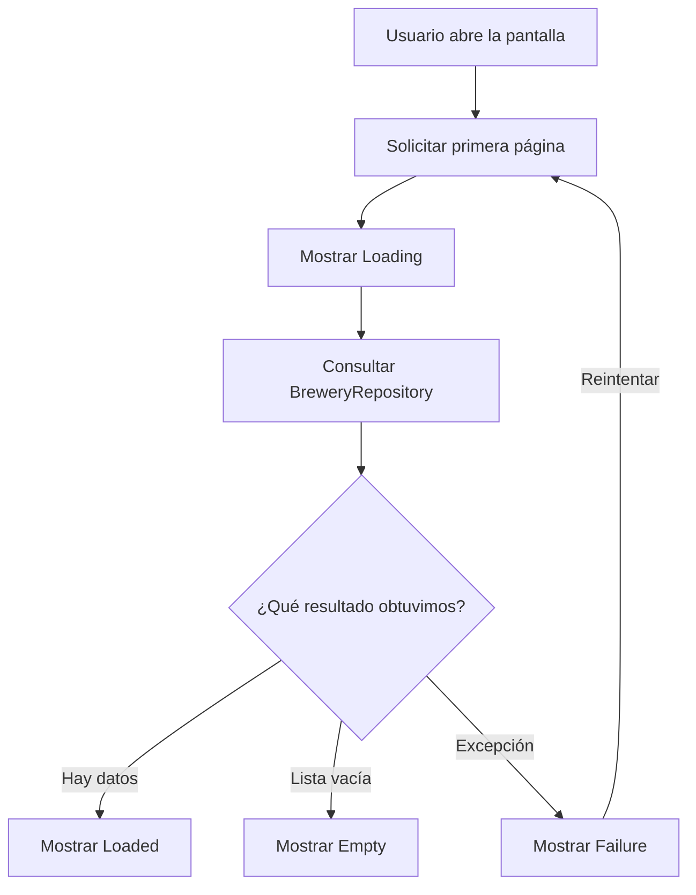
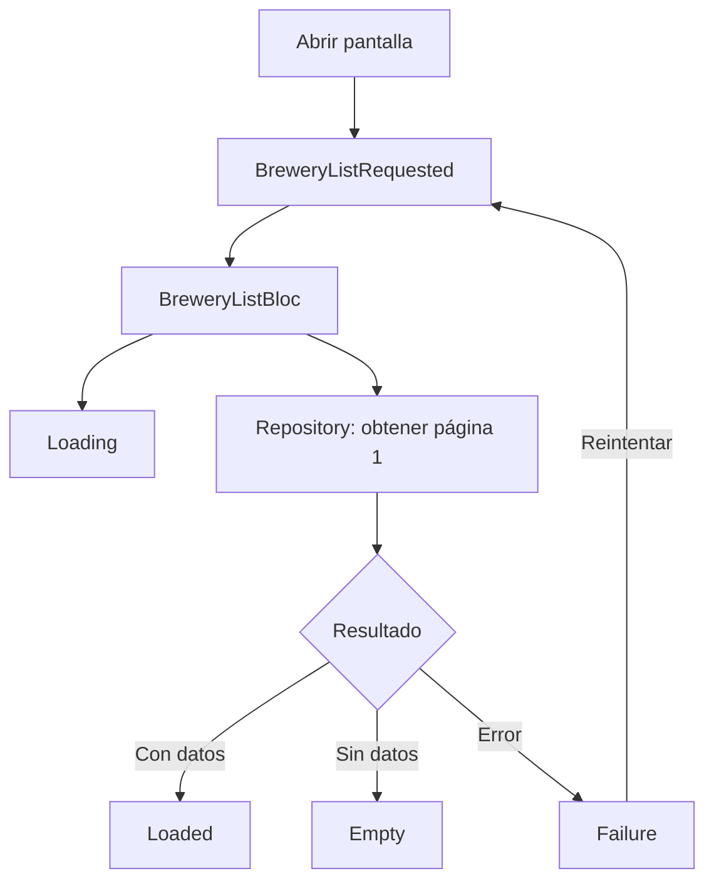
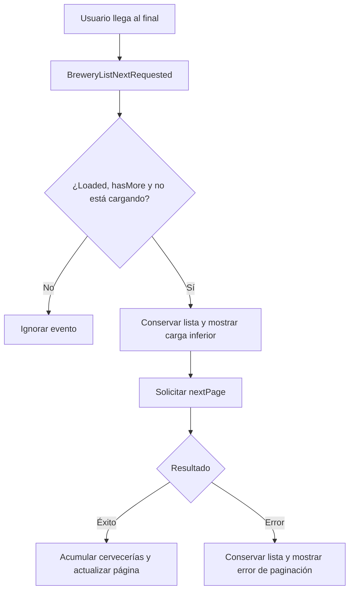
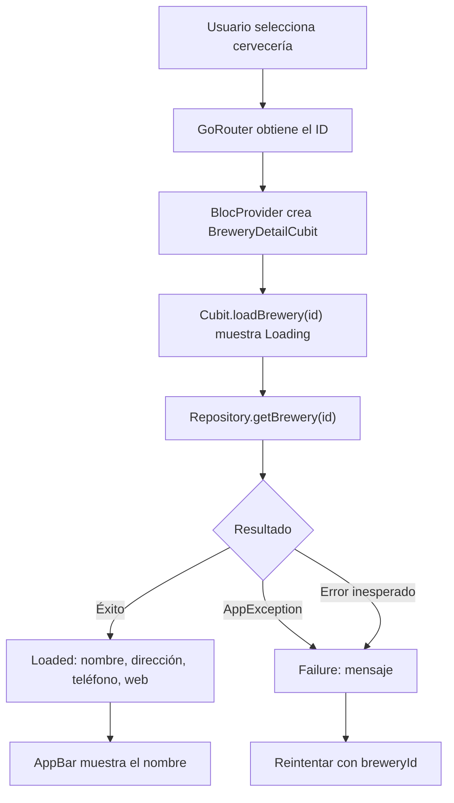
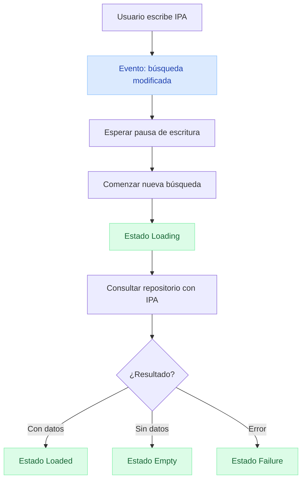
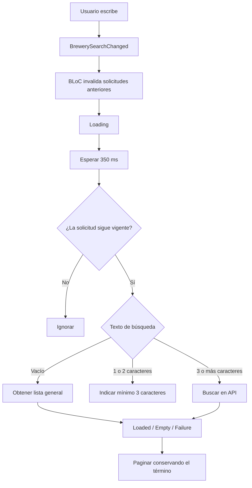
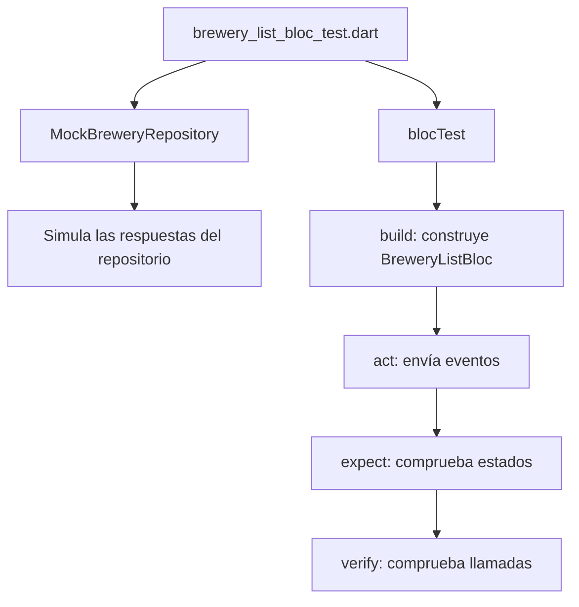

# forestchallenger

App Flutter que consume [Open Brewery DB](https://www.openbrewerydb.org/) para listar, buscar y ver el detalle de cervecerías. Usa Clean Architecture (Domain / Data / Presentation), BLoC y Cubit para el estado, e inyección de dependencias con `get_it` + `injectable`.

- API: `https://api.openbrewerydb.org/v1`
- Entrada: `main.dart` → `configureDependencies()` → `AppRouter` → `MaterialApp.router`

## Índice

- [Stack](#stack)
- [Arquitectura](#arquitectura)
- [Conceptos (Event → Bloc → State)](#conceptos-event--bloc--state)
- [Flujos](#flujos)
- [Estados](#estados)
- [Estructura del proyecto](#estructura-del-proyecto)
- [Inyección de dependencias](#inyección-de-dependencias)
- [Pruebas](#pruebas)
- [Comandos](#comandos)
- [Estado del proyecto](#estado-del-proyecto)

## Stack

Dependencias principales:

| Paquete | Uso |
| --- | --- |
| `flutter_bloc` | BLoC y Cubit en la capa de presentación |
| `bloc_concurrency` | Transformers de eventos (`droppable` en paginación) |
| `dio` | Cliente HTTP hacia Open Brewery DB |
| `get_it` + `injectable` | Inyección de dependencias (código generado) |
| `equatable` | Comparación por valor en entidades y estados |
| `go_router` | Navegación (`/breweries`, `/breweries/:id`) |
| `stream_transform` | Utilidades de streams |

Dev: `bloc_test`, `mocktail`, `build_runner`, `injectable_generator`.

## Arquitectura

```text
PRESENTATION (Screen - Widgets - Bloc - Cubit)
  BreweryListScreen + BreweryDetailScreen
  BreweryListBloc + BreweryDetailCubit
        |
        v
DOMAIN (Entities - Repository)
  Brewery
  BreweryRepository (contrato)
        ^
        |
DATA (RepositoryImpl - Datasource - DTO (Data transfer object))
  BreweryRepositoryImpl
  BreweryRemoteDataSource
  BreweryDto + Dio
```

Responsabilidades:

- **Presentation:** pantallas y estado de UI. `BreweryListBloc` maneja listado, búsqueda con debounce y paginación; `BreweryDetailCubit` maneja el detalle.
- **Domain:** entidad `Brewery` y el contrato `BreweryRepository`. No depende de Flutter ni de Dio.
- **Data:** implementa el contrato (`BreweryRepositoryImpl`), llama al datasource remoto y mapea DTO → entidad.

Se usó BLoC para el listado por la interacción entre paginación, carga y búsqueda; y Cubit para el detalle, cuyo flujo es más simple. La separación entre capas se apoya en el contrato de repositorio y la inyección de dependencias.

## Conceptos (Event → Bloc → State)

| Pregunta | Respuesta | Concepto |
| --- | --- | --- |
| ¿Qué ocurrió? | Se solicitó la lista | Event |
| ¿Qué debe hacer la app? | Consultar el repositorio | Bloc |
| ¿Qué debe mostrar la pantalla? | Loading, Loaded o Failure | State |

## Flujos

### Apertura de la app



### Listado



### Paginación



### Detalle de la cervecería



### Búsqueda

Implementada en `BreweryListBloc` con el evento `BrewerySearchChanged`: debounce de 350 ms, transformer `restartable` y un contador de generación que descarta respuestas obsoletas. La API (`/breweries/search`) exige al menos 3 caracteres; con menos, el BLoC emite `Empty` sin llamar al repositorio.




## Estados

- **Listado** (`BreweryListState`): `Initial`, `Loading`, `Loaded`, `Empty`, `Failure`. Todos llevan `query` (búsqueda activa) y `Loaded` añade `isLoadingMore` y `paginationError` para la carga incremental.
- **Detalle** (`BreweryDetailState`): `Initial`, `Loading`, `Loaded`, `Failure`.

## Estructura del proyecto

```text
lib/
  main.dart
  core/
    di/          injection.dart, injection.config.dart (generado)
    errors/      app_exception.dart, dio_exception.dart
    network/     api_url.dart (Dio + baseUrl)
    router/      app_router.dart
  domain/
    entities/    brewery.dart
    repositories/brewery_repository.dart
  data/
    datasources/ brewery_remote_datasource.dart
    models/      brawery_dto.dart
    repositories_impl/ brewery_repository_impl.dart
  presentation/
    bloc/        brewery_list_bloc.dart (+ event, state)
    cubit/       brewery_detail_cubit.dart (+ state)
    screens/     brewery_list_screen.dart, brewery_details_screen.dart
    widgets/     brewery_tile.dart (usado por el listado)
    brewery_type_label.dart
test/
  presentation/
    bloc/  brewery_list_bloc_test.dart
    cubit/ brewery_detail_cubit_test.dart
```

## Inyección de dependencias

`configureDependencies()` en `core/di/injection.dart` inicializa `get_it` con `injectable`. El grafo se genera en `injection.config.dart` con `build_runner`:

- `Dio` → `lazySingleton` (`ApiUrl`)
- `BreweryRemoteDatasource` → `lazySingleton`
- `BreweryRepositoryImpl` → `LazySingleton` como `BreweryRepository`
- `BreweryListBloc` y `BreweryDetailCubit` → `factory` (instancia nueva por pantalla)

Tras cambiar anotaciones, regenerar con `dart run build_runner build --delete-conflicting-outputs`.

## Pruebas

Un test de BLoC responde tres preguntas:

- **Given:** ¿en qué situación comenzamos?
- **When:** ¿qué evento ejecutamos?
- **Then:** ¿qué estados esperamos recibir?

Responsabilidad de cada etapa:



Cobertura actual:

- `brewery_list_bloc_test.dart`: carga inicial (Loading → Loaded), lista vacía (Empty), error (`ServerException` → Failure), paginación (acumula página 2) y fallo en página 2 (conserva la lista y expone `paginationError`).
- `brewery_detail_cubit_test.dart`: detalle exitoso (Loading → Loaded) y fallo de red (Loading → Failure).
- Búsqueda: sin pruebas dedicadas todavía.

Ejecutar:

```sh
flutter test
```

## Comandos

```sh
flutter pub add dio
flutter pub add bloc_concurrency
flutter pub add flutter_bloc
flutter pub add get_it
flutter pub add injectable
flutter pub add equatable
flutter pub add go_router
flutter pub add stream_transform
# dev
flutter pub add --dev bloc_test
flutter pub add --dev mocktail
```

## Estado del proyecto

- Listado con paginación: implementado (`BreweryListBloc`, `brewery_list_screen.dart`).
- Detalle y navegación: implementado (`BreweryDetailCubit`, `brewery_details_screen.dart`, ruta `/breweries/:id`).
- Búsqueda con debounce: implementado (`BrewerySearchChanged` en el BLoC, `searchBreweries` en datasource/repositorio y campo de búsqueda en `brewery_list_screen.dart`).
- Pruebas: BLoC del listado y Cubit del detalle.

## Notas

- Entidades generadas desde el JSON con [quicktype](https://app.quicktype.io/).
