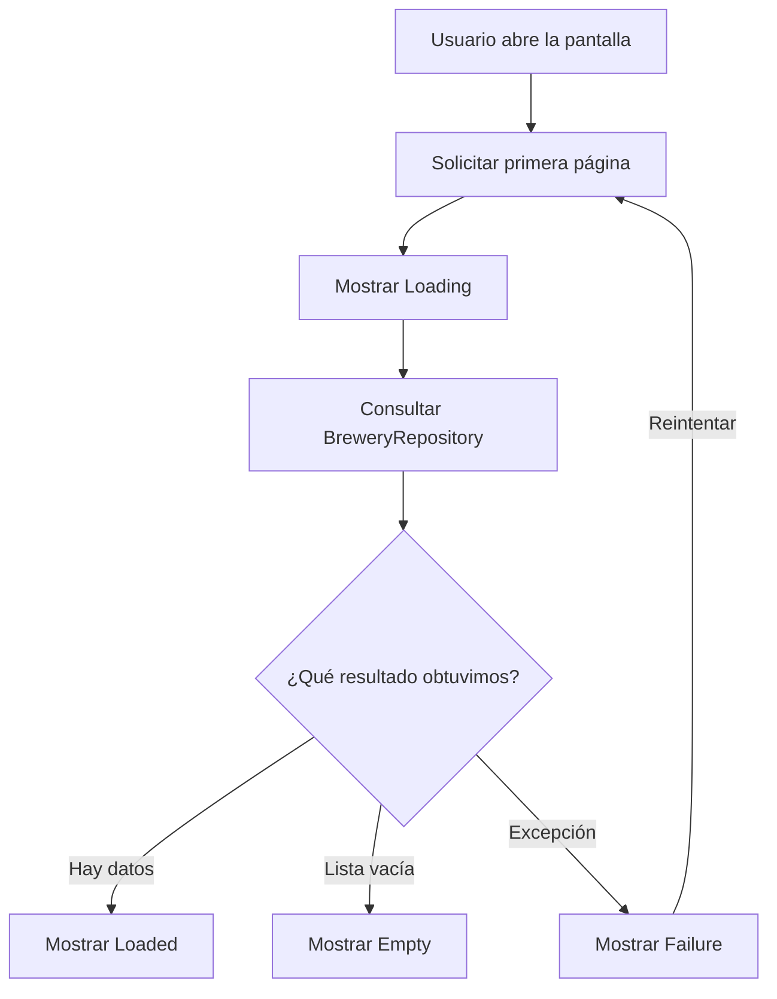
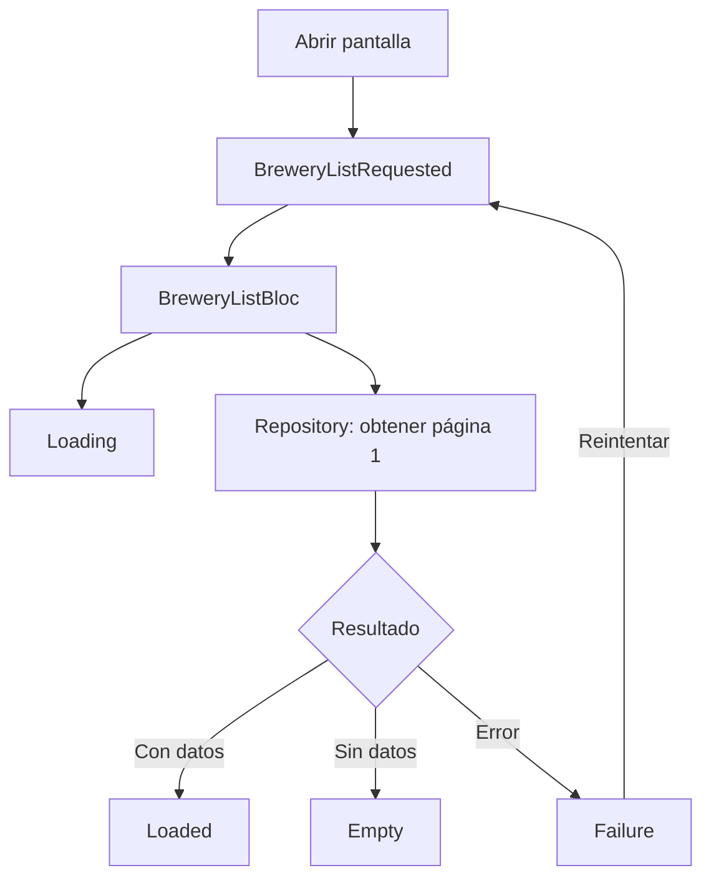
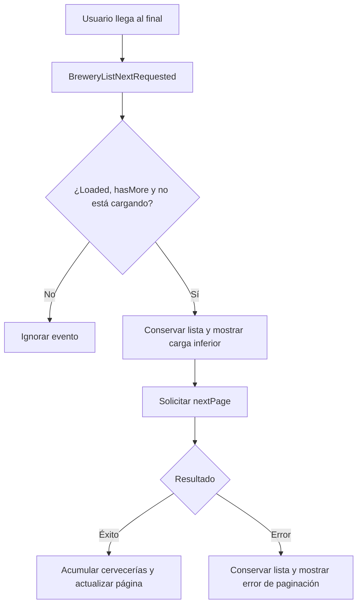
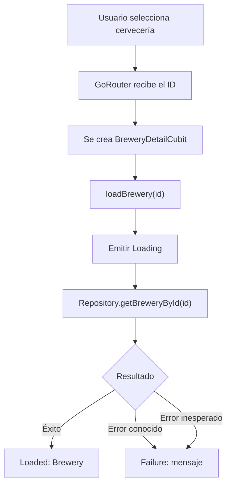
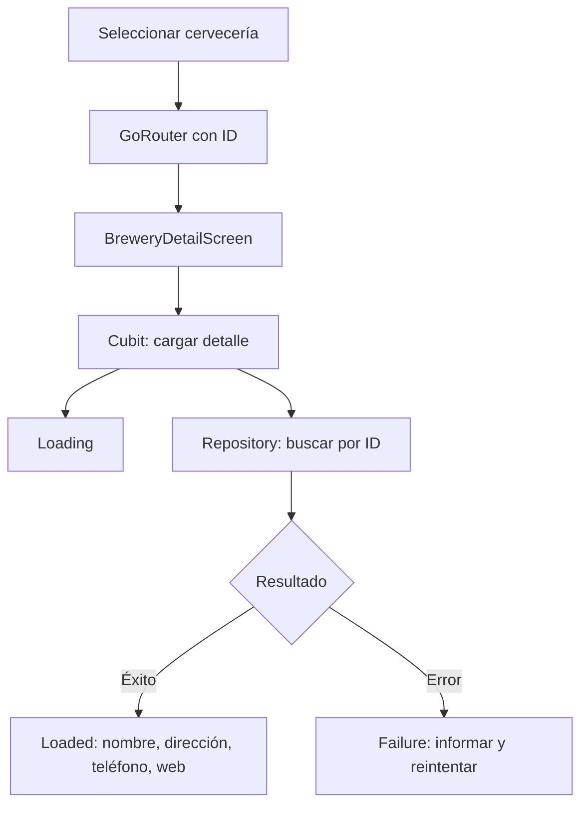
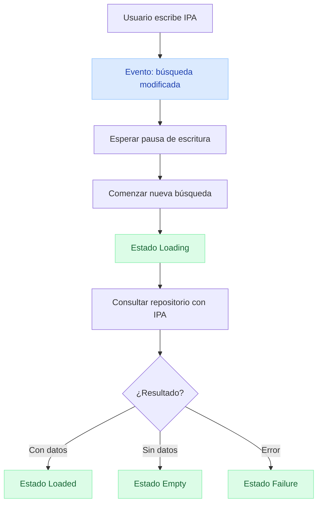
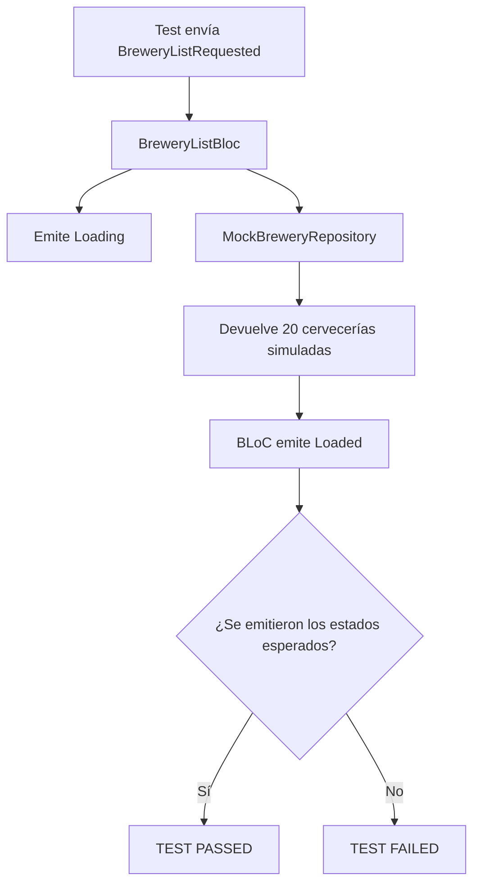
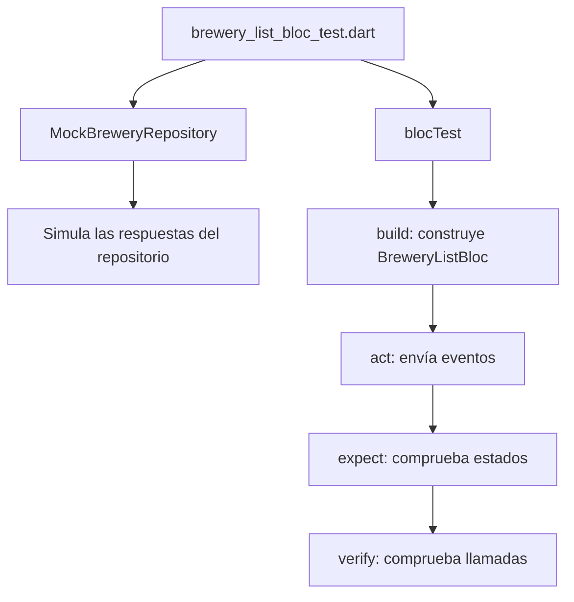

# forestchallenger

App Flutter de cervecerías (Open Brewery DB) con Clean Architecture, BLoC y inyección de dependencias.

## Conceptos

Pregunta -> Respuesta -> Concepto

- Que ocurrio? -> Se solicito lista -> Event
- Que debe hacer la app -> Consultar Repo -> Bloc
- Que debe mostrar en screen -> Loading, Loaded o Failure -> State

## Arquitectura

```text
PRESENTATION (Screen - Widgets - Bloc - Cubit)
  BreweryListScreen + BreweryDetailScreen
  BreweryListBloc + BreweryDetailCubit
        |
        v
DOMAIN (Entities - Repository)
  Brewery
  BreweryRepository (contrato)
        ^
        |
DATA (RepositoryImpl - Datasource - DTO (Data transfer object))
  BreweryRepositoryImpl
  BreweryRemoteDataSource
  BreweryDto + Dio
```
## Estados

`Initial`, `Loading`, `Loaded`, `Failure`, `Empty`

## AL ABRIR LA APP



Se utilizó BLoC para el listado debido a la interacción entre paginación, estados de carga y búsqueda. Para el detalle se utilizó Cubit, ya que su flujo es más sencillo. La aplicación separa Domain, Data y Presentation mediante contratos de repositorio e inyección de dependencias. Se priorizó completar las funcionalidades principales y agregar pruebas significativas antes de implementar funcionalidades opcionales.

Herramienta usada para generar las entidades desde el JSON: https://app.quicktype.io/


## LISTADO



## PAGINACION



## DETALLE DE LA CERVECERIA

Pendiente: `BreweryDetailScreen` es un `Placeholder`, la ruta está comentada y no existe el Cubit.



## Buscar

Pendiente (Fase 3): `BrewerySearchChanged` está comentado.




## TEST



Un TEST en bloc debe responder 3 preguntas:

- Given: ¿en qué situación comenzamos?
- When: ¿qué evento ejecutamos?
- Then: ¿qué estados esperamos recibir?

Responsabilidad de cada etapa del test:



## Comandos

```sh
flutter pub add dio
flutter pub add bloc_concurrency
flutter pub add flutter_bloc
flutter pub add get_it
flutter pub add injectable
flutter pub add equatable
flutter pub add go_router
flutter pub add stream_transform
# dev
flutter pub add --dev bloc_test
flutter pub add --dev mocktail
```

## Estado

- Listado con paginación: implementado (`BreweryListBloc`).
- Detalle y navegación: pendiente.
- Búsqueda con debounce: pendiente.
- Pruebas del BLoC: implementado (`test/presentation/bloc/brewery_list_bloc_test.dart`).
